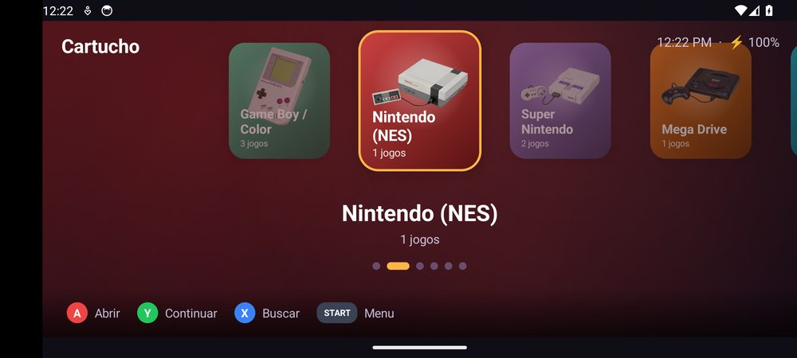
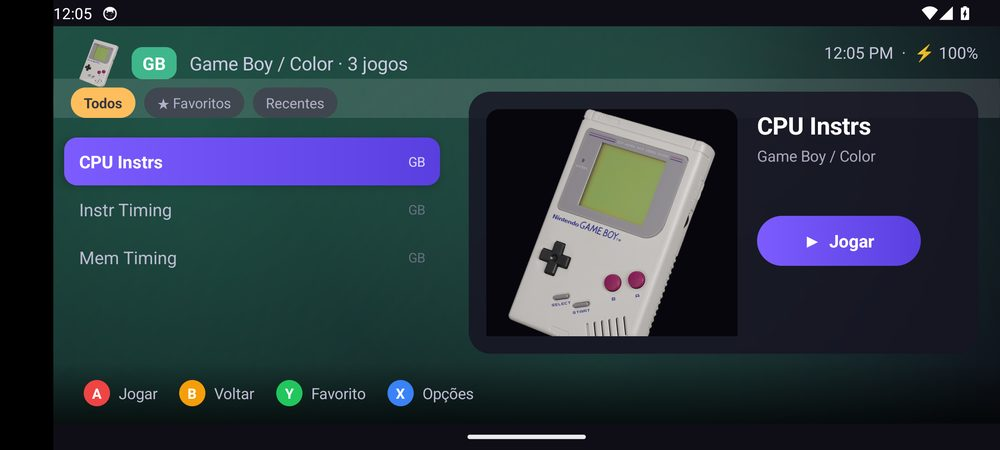
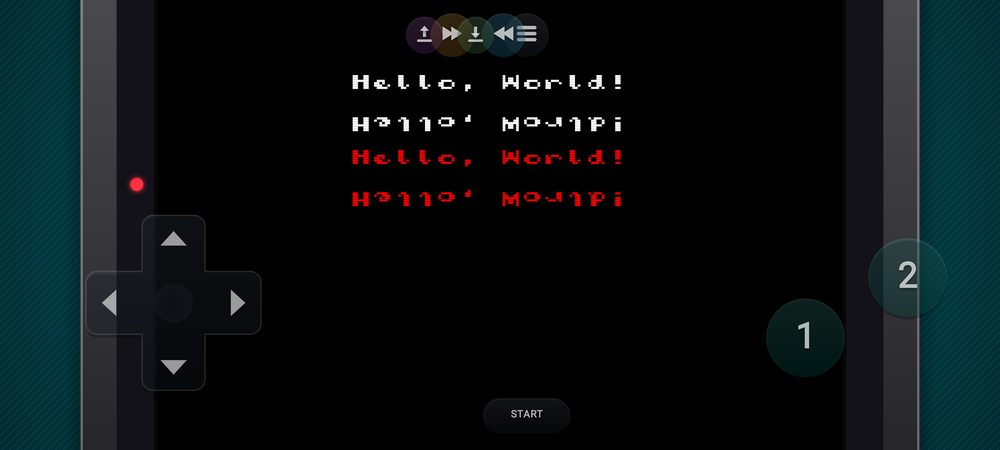
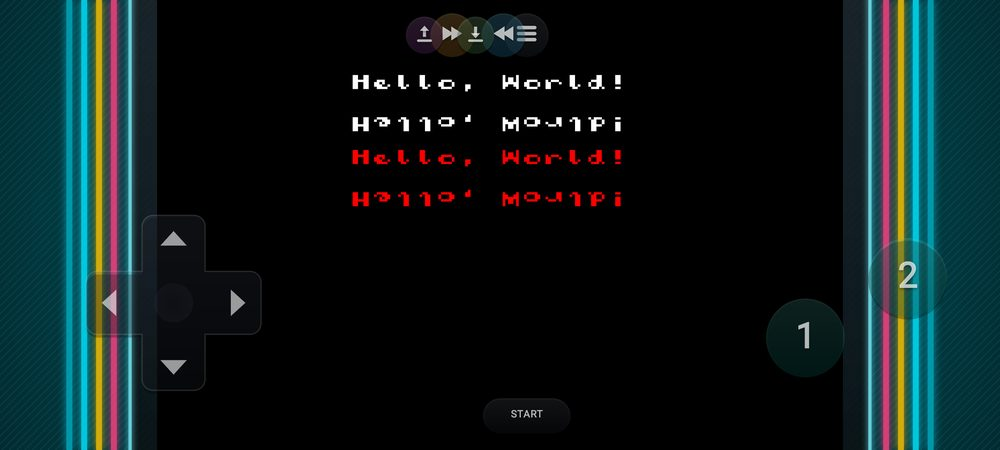
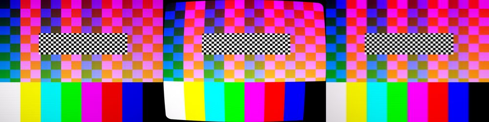
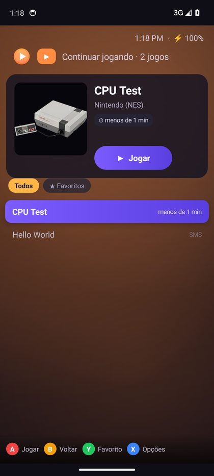
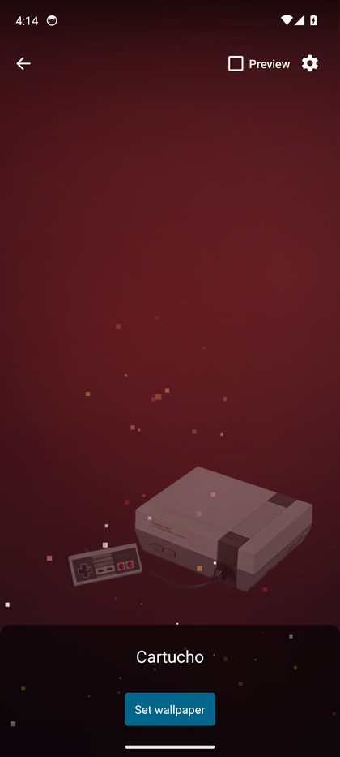

# Cartucho

Emulador para Android que joga **Game Boy Advance**, **Game Boy / Color**,
**Nintendo DS**, **Nintendo 3DS**, **NES**, **Super Nintendo**, **Mega Drive**,
**Master System**, **Game Gear** e **PlayStation** num app só. Tem biblioteca
com capas, controle na tela colorido e configurável, controles físicos,
conquistas, saves na nuvem e gravação de vídeo.

Por dentro, o Cartucho é um *frontend* próprio que carrega os emuladores como
módulos (cores no formato libretro):

| Console | Emulador | Licença |
|---|---|---|
| Game Boy Advance, Game Boy, Game Boy Color | [VisualBoyAdvance-M](https://github.com/visualboyadvance-m/visualboyadvance-m) | GPL-2.0 |
| Nintendo DS | [melonDS DS](https://github.com/JesseTG/melonds-ds) (melonDS) | GPL-3.0 |
| Nintendo 3DS | [Azahar](https://github.com/azahar-emu/azahar) | GPL-2.0+ |
| NES | [FCEUmm](https://github.com/libretro/libretro-fceumm) | GPL-2.0 |
| Super Nintendo | [Snes9x](https://github.com/libretro/snes9x) | licença própria (não comercial) |
| Mega Drive, Master System, Game Gear | [Genesis Plus GX](https://github.com/libretro/Genesis-Plus-GX) | licença própria (não comercial) |
| PlayStation | [PCSX ReARMed](https://github.com/libretro/pcsx_rearmed) | GPL-2.0 |

Conquistas: [rcheevos](https://github.com/RetroAchievements/rcheevos) (MIT),
em `app/src/main/cpp/third_party/rcheevos`, com
[libchdr](https://github.com/rtissera/libchdr) (BSD) para reconhecer discos `.chd`.
Dados dos jogos: [libretro-database](https://github.com/libretro/libretro-database).

Os emuladores são compilados direto do código oficial pelo workflow **Build
cores** (`.github/workflows/cores.yml`, versões fixadas nas variáveis `*_SHA`),
que publica o resultado na release `cores`. O VBA-M recebe o patch
`.github/patches/vbam-cartucho.patch`, que traz link cable no Android, estados
completos do Game Boy e o agendador do GBA nos estados. O workflow **Build
APK** roda a cada envio e monta o app em poucos minutos usando esses cores.

## Telas

  
  

  
  

  
  

  

*(Capturas do emulador de testes, com ROMs de teste livres.)*

## Baixar e instalar

**[⬇️ Baixar o Cartucho (APK)](https://github.com/carlospjjj-oss/cartucho/releases/latest)**: em
*Assets*, toque no arquivo `Cartucho-N.apk`.

1. Abra o arquivo baixado. Na primeira vez, o Android pede para permitir que
   o navegador (ou o app de arquivos) instale apps; permita.
2. Abra o Cartucho, toque em **Adicionar pasta** e escolha a pasta dos seus
   jogos. 3DS e PlayStation pedem também "Acesso a todos os arquivos".
3. Pronto. As capas e as informações dos jogos são baixadas sozinhas.

Precisa de Android 9 ou mais novo, num celular, tablet ou TV com processador
ARM de 64 bits (quase todos de hoje). DS, 3DS e PlayStation pedem um aparelho
mais forte.

**Atualizações:** o próprio app avisa quando sai uma versão nova (ao abrir, no
máximo a cada 6 horas), mostra as novidades, baixa e chama o instalador. Dá
para desligar o aviso ou procurar na hora em Configurações → Sobre o app. Toda
versão é assinada com a mesma chave, então instala por cima da anterior sem
perder os saves.

Cada envio para `main` gera um APK novo, publicado em **Releases → latest** pelo
workflow **Build APK**.

## Formatos de jogo

| Console | Arquivos |
|---|---|
| GBA | `.gba` |
| Game Boy / Color | `.gb` `.gbc` |
| DS | `.nds` |
| 3DS | `.3ds` `.cci` `.cxi` `.3dsx` (descriptografados) |
| NES | `.nes` `.fds` |
| Super Nintendo | `.sfc` `.smc` |
| Mega Drive | `.md` `.gen` `.smd` `.bin` |
| Master System / Game Gear | `.sms` / `.gg` |
| PlayStation | `.chd` `.cue`+`.bin` `.pbp` `.m3u` |

Também abre `.zip` e `.7z`, que são extraídos na primeira vez que você joga.
3DS e PlayStation abrem direto da pasta e pedem a permissão "Acesso a todos os
arquivos".

## O que tem

**Visual de console** (parecido com o Batocera; a grade de capas continua como opção)
- Carrossel de consoles com fotos reais de cada aparelho, cores e fundo
  animado de cada console, sons de navegação e música de fundo (ou a sua).
- Lista de jogos com painel: capa, **tela de título e capturas** se
  alternando, logotipo do jogo, um fundo com uma imagem do jogo, dados,
  tempo jogado e saves.
- **Prévia em movimento:** os seus últimos momentos no jogo, ou o vídeo de
  gameplay do ScreenScraper (só no Wi-Fi, por padrão).
- Feito para controle e controle remoto (A/B/X/Y, L/R, START), e também por
  toque.

**Tela inicial do Android**
- Widget **Continuar jogando**: o último jogo com a imagem de onde você parou,
  o console e o tempo jogado; um toque e você volta para o jogo.
- Widget **Jogos recentes**: as capas dos últimos quatro jogos.
- **Papel de parede animado:** o brilho do visual de console nas cores do
  console do último jogo (ou de um que você escolher, ou trocando a cada meia
  hora), com pixels subindo como faíscas e a foto do console; tocar na tela
  solta uma explosão de pixels. Só anima enquanto aparece na tela.

**Biblioteca**
- Capas, filtros por console (só dos consoles que você tem), favoritos,
  recentes e busca.
- Fileira **Continuar jogando**, com a imagem de onde você parou, e tempo de
  jogo de cada jogo.
- Atalho de um jogo na tela inicial do Android. Segurar o ícone do app mostra
  os últimos jogos.
- **Detalhes do jogo:** ano, gênero, desenvolvedora, distribuidora e número de
  jogadores (base da libretro), e descrição (ScreenScraper, em português, ou
  TheGamesDB).
- **Android TV / Google TV:** aparece na tela inicial da TV e dá para navegar
  pela biblioteca com o controle remoto ou com um controle de videogame.
- De onde vêm as capas, em ordem de preferência:
  1. A capa que você escolheu.
  2. As que o Skraper/EmulationStation deixaram na pasta dos jogos (`media/...`, `gamelist.xml`).
  3. O seu repositório de capas.
  4. O ScreenScraper (com sua conta).
  5. O acervo libretro.
  6. O TheGamesDB (com sua chave).

**Jogando**
- **Continuar de onde parou:** ao sair, o jogo é salvo no ponto exato e
  continua dali (menos 3DS).
- 6 slots de save state por jogo, cada um com a imagem do momento, mais
  salvar/carregar rápido na tela; saves de bateria automáticos.
- **Configurações por jogo:** filtro, cores, run-ahead, velocidade, visual e
  layout dos botões só daquele jogo.
- Voltar no tempo (segure «) e acelerar (2x a 6x).
- Run-ahead (1 ou 2 quadros) para menos atraso nos botões. O app confere
  sozinho se o jogo aceita e desliga quando não aceita.
- Trapaças: digitadas (GameShark, Action Replay, CodeBreaker, Game Genie…) ou
  **prontas**, buscadas na base do RetroArch.
- 🏆 **Conquistas do RetroAchievements:** avisos na tela e lista no menu.
- 🎬 **Gravar vídeo** do jogo (MP4, imagem e som, sem os botões) em
  Filmes/Cartucho, e captura de tela em Imagens/Cartucho.

**Imagem**
- Filtros: nítido, suave, nítido suave, tela LCD, linhas de TV, TV de tubo
  (CRT), **TV de tubo curva** (vidro curvo, cantos arredondados e brilho),
  **TV antiga** (cabo composto, cores escorrendo) e bordas arredondadas
  Scale2x/Scale3x.
- **Molduras** em volta do jogo nas faixas vazias da tela: corpo de portátil,
  TV de tubo ou fliperama, nas cores do console (automática por console, ou
  escolhida por jogo).
- Cores de tela real do GBA/GBC (GBA, GBA SP, Micro, DS Lite, Switch Online),
  paletas do Game Boy clássico e mistura de quadros para transparências.
- 3DS: filtros de textura (xBRZ, ScaleForce, MMPX, Anime4K), cache de
  shaders, resolução interna até 4x, layouts das duas telas e New 3DS.

**Controles**
- Controle na tela com visual **Moderno colorido**, **Neon** ou **Clássico**,
  e as cores de cada console (A/B/X/Y do Super Nintendo, △○✕□ do PlayStation,
  A B C do Mega Drive…).
- Multitoque e vibração, transparência e tamanho ajustáveis, e modo de edição
  para arrastar e redimensionar cada botão.
- Controles Bluetooth/USB e teclado, com **mapeamento próprio**: qualquer
  botão do controle pode acelerar, voltar no tempo, salvar/carregar rápido ou
  abrir o menu.
- Sensor de movimento, vibração e microfone (DS: botão MIC).
- Mega Drive com controle de 6 botões (X Y Z); PlayStation com DualShock
  (analógicos no controle e, se quiser, na tela) e troca de disco (.m3u).

**Conexões**
- 🌐 **Jogo online (2 jogadores):** os dois abrem o mesmo jogo; um cria a sala
  (jogador 1) e o outro entra (jogador 2). No mesmo Wi-Fi as salas aparecem
  sozinhas; pela internet, com Tailscale/ZeroTier ou a porta 5740 aberta.
  Usa *rollback* (como os jogos de luta modernos): o jogo não espera a rede;
  quando a jogada do outro chega diferente do previsto, os quadros são
  refeitos na hora. Os saves de quem entra não são alterados. Funciona em
  todos os consoles menos DS e 3DS.
- **Link cable pela rede** (GBA e Game Boy): as partidas no mesmo Wi-Fi
  aparecem sozinhas. Funciona com cabo de GBA (2 a 4 jogadores) e com o
  adaptador sem fio (Union Room de Pokémon). Conecta também com o VBA-M de PC.
  **Pela internet** também: com o app Tailscale (ou ZeroTier/Radmin) nos dois
  aparelhos, ou com a porta 5738 aberta no roteador de quem hospeda.
- **Modo TV:** com o celular ligado a uma TV (HDMI, Chromecast/Smart View), o
  jogo vai para a TV e o celular vira o controle.
- ☁️ **Saves na nuvem:** um arquivo no Google Drive/OneDrive/Dropbox,
  atualizado depois de cada jogatina; outro celular baixa do mesmo arquivo.
- Backup dos saves num .zip e restauração.
- Relatório de erro (com o registro de crash do Android), pronto para copiar.

## Ainda não tem

- BIOS: nenhuma vem no app (são da Nintendo/Sony). Nenhuma é obrigatória; em
  Configurações → BIOS dá para importar as do seu próprio console (GBA, GB,
  GBC, PlayStation).
- Instalar arquivos `.cia` no 3DS.
- Conquistas no 3DS.

## Jogos e arquivos de sistema

O Cartucho não vem com jogos, BIOS ou chaves. Use cópias dos seus próprios
jogos. Jogos de 3DS precisam estar **descriptografados**.

## Licença

O código do Cartucho é GPL-2.0 ou posterior. Os emuladores mantêm as licenças
de cada projeto (tabela acima) e são distribuídos como bibliotecas separadas.
Snes9x e Genesis Plus GX só permitem uso **não comercial**: o Cartucho é e
continua grátis, e não pode ser vendido.

As fotos dos consoles são de Evan-Amos, do Wikimedia Commons (domínio público,
e CC BY-SA 3.0 a do Super Nintendo); a lista está em
[`tools/art/PHOTO_CREDITS.md`](tools/art/PHOTO_CREDITS.md). As marcas que
aparecem nos aparelhos pertencem aos seus donos.

## Compilar

O jeito mais fácil é fazer um *fork* e deixar o GitHub Actions trabalhar:

1. Rode o workflow **Build cores** uma vez (pode levar mais de meia hora): ele compila os
   emuladores e publica na release `cores`.
2. Cada envio roda o **Build APK**, que monta o app com esses cores em poucos
   minutos e publica na release `latest`.
3. Para assinar com a sua própria chave (e o app atualizar por cima), crie um
   keystore com senha `cartucho` e guarde-o em base64 no segredo
   `CARTUCHO_KEYSTORE_B64` do repositório. Sem ele, o APK sai com a chave de
   depuração.

Na sua máquina: Android Studio (ou Gradle 8.11) com o NDK
`29.0.14206865`; baixe os `.so` da release `cores` para
`app/src/main/jniLibs/arm64-v8a/` e rode `gradle assembleRelease`. Os testes
do motor rodam no Linux com `tools/host-test/run.sh`.

O workflow **Screenshots** monta um APK também para x86_64, com os
emuladores de NES e Sega, roda o app num emulador de Android, abre jogos de
teste e publica as capturas na release `screens`.

## Estrutura

- `app/src/main/cpp/` — o motor nativo:
  - carrega o core (`core_host`);
  - desenha com OpenGL ES 3 e cuida dos filtros (`gl_presenter`);
  - áudio AAudio com reamostragem (`audio_output`, `resampler`);
  - ritmo dos quadros, modo TV e link (`session`);
  - voltar no tempo (`rewind`), run-ahead (`runahead`), conquistas (`achievements`) e gravação de vídeo (`recorder`);
  - jogo online com rollback (`netplay`);
  - a ponte JNI (`android_jni`).
- `app/src/main/java/com/cartucho/emu/` — o app:
  - biblioteca, tela do jogo, controle na tela (`ControllerOverlay`, `ButtonPainter`) e controles físicos (`GamepadInput`, `PadMap`);
  - capas, trapaças (`Cheats`, `CheatDb`), conquistas (`RetroAchievements`);
  - nuvem (`CloudSync`), vídeo (`VideoRecorder`) e configurações.
- `tools/host-test/` — testes do motor que rodam no Linux, inclusive com
  cores reais e ROMs de teste: ritmo, áudio, OpenGL, TV, voltar no tempo,
  run-ahead, link, conquistas (com servidor falso), gravação e jogo online
  (dois aparelhos simulados, com atraso e dessincronização).
- `tools/art/` — as fotos dos consoles (busca no Wikimedia Commons) e os
  desenhos das coleções.
